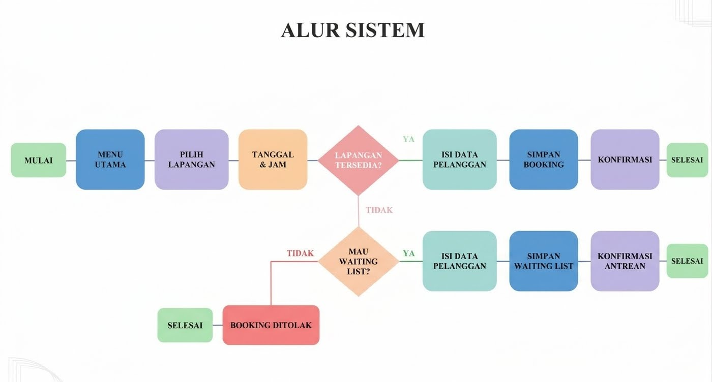

# ArenaGo

**Tugas Besar Struktur Data — Sistem Booking Lapangan**

> **Catatan (Rancangan Awal):** Seluruh struktur file, rancangan fungsi, pembagian fitur, dan log dalam dokumen ini masih bersifat **rancangan awal (*initial draft*)** dan **dapat berubah sewaktu-waktu** menyesuaikan perkembangan pengerjaan kode, kendala teknis di lapangan, maupun arahan dosen/asisten praktikum.

**ArenaGo** adalah aplikasi berbasis konsol yang dibangun menggunakan bahasa pemrograman **C++** untuk mengelola pemesanan (*booking*) lapangan olahraga. Sistem ini mengimplementasikan struktur data utama **Multi Linked List (MLL)** untuk menghubungkan data lapangan dengan daftar jadwal pemesanannya, serta **Queue** untuk mengelola antrean *waiting list* pemesanan.

**Anggota Kelompok / NIM / Kelas:**

1. Hafis Saputra / 109082500087 / S1IF-13-01
2. Rafli Nurhidayat / 109082500152 / S1IF-13-04
3. Danar Prastika Okka Raharja / 109082600169 / S1IF-13-03
4. Denis Ramadhani / 109082500060 / S1IF-13-02

**Rencana Struktur File *(dapat berubah)*:**

```text
ArenaGo/
├── assets/
│   └── alur_sistem.png
├── mll.h
├── mll.cpp
├── queue.h
├── queue.cpp
├── fitur.h
├── fitur.cpp
├── menu.h
├── menu.cpp
├── main.cpp
├── data.txt
└── README.md
```

---

## Diagram Alur Sistem (Flowchart)

Berikut adalah rancangan alur kerja sistem (*flowchart*) untuk proses pemesanan lapangan, penanganan jadwal bentrok melalui *Waiting List* (*Queue*), hingga konfirmasi booking:

<p align="center">
  
</p>

> **Penjelasan Alur Revisi:**
> * Jika **Lapangan Tersedia (YA)**: Pelanggan langsung mengisi data, sistem menyimpan booking ke dalam *Child* MLL, dan booking terkonfirmasi.
> * Jika **Lapangan Tidak Tersedia (TIDAK)**: Sistem menawarkan opsi masuk ke **Waiting List**. Jika memilih **YA**, data pelanggan dimasukkan ke dalam antrean (*Queue*). Jika memilih **TIDAK**, barulah sistem memunculkan status **Booking Ditolak**.

---

## 0. Catatan Revisi & Tugas Tambahan dari Dosen

Bagian ini mencatat masukan dan tugas tambahan yang diberikan dosen saat bimbingan, yang masih perlu dikerjakan.

| No | Tanggal | Catatan dari Dosen | Status |
| :--- | :--- | :--- | :--- |
| 1 | 21/11/2026 | Pada daftar booking, perlu ditambahkan keterangan **status** — misalnya kalau jadwalnya sedang berjalan, tampil "Sedang Berlangsung". Jadi user bisa tahu booking mana yang sedang aktif. | **Belum** |
| 2 | | | |
| 3 | | | |

**Keterangan Status:**
- **Belum** — belum dikerjakan.
- **Sedang** — sedang dikerjakan.
- **Selesai** — sudah selesai.

---

## 1. Log Progress & Pembagian Fitur *(Tentatif)*

Daftar ini digunakan untuk memantau status pengerjaan setiap modul dan alur sistem:

- [x] Perancangan awal struktur data (`mll.h` & `queue.h`)
- [x] Implementasi operasi dasar MLL (`mll.cpp`: *create*, *insert*, *search*, *delete*)
- [x] Implementasi operasi dasar Queue untuk Waiting List (`queue.cpp`: *enqueue*, *dequeue*)
- [x] Fitur Pilih Lapangan & Input Tanggal/Jam
- [x] Fitur Validasi Ketersediaan Lapangan (Cek jadwal bentrok & opsi masuk *waiting list*)
- [x] Fitur Simpan Data Pelanggan & Konfirmasi Booking / Antrean Waiting List
- [x] Fitur Pembatalan Booking (*Cancel*) & Promosi Otomatis dari Waiting List
- [x] Antarmuka Menu Utama (`menu.h` & `menu.cpp`)
- [x] Integrasi & Pengujian Akhir (`main.cpp`)
- [x] *Tambahan:* Fitur Login Admin (maks. 3 percobaan)
- [x] *Tambahan:* Fitur Hapus Booking & Batal Waiting List
- [x] *Tambahan:* Fitur Cek Booking & Lihat Semua Booking
- [x] *Tambahan:* Persistensi Data ke File (`data.txt`)
- [ ] *Tambahan:* Fitur Status Booking Dinamis ("Sedang Berlangsung") — **menunggu revisi dosen**

---

## 2. Log Perubahan dan Penambahan

Catatan setiap kali ada penyesuaian konsep, penambahan fungsi baru, perubahan struktur kode, atau pembaruan file.

| Tanggal | Nama | File Terkait | Deskripsi Perubahan / Penambahan |
| :--- | :--- | :--- | :--- |
| 16/11/2026 | Hafis Saputra | `mll.h` | Membuat rancangan awal `struct Lapangan` (Parent) dan `struct Booking` (Child). |
| 16/11/2026 | Hafis Saputra | `mll.cpp` | Menambahkan fungsi `cekKetersediaan()` dan `simpanBooking()`. |
| 17/11/2026 | Tim | `queue.h`, `queue.cpp`, `fitur.cpp` | **Revisi Alur:** Jika jadwal sudah terisi, booking tidak langsung ditolak melainkan ditawarkan masuk ke **Waiting List** menggunakan struktur data *Queue* (FIFO). |
| 18/11/2026 | Tim | `fitur.cpp`, `mll.cpp` | Menambahkan fungsi `cancelBooking()` yang otomatis memindahkan antrean terdepan (*dequeue*) dari *Waiting List* menjadi booking terkonfirmasi saat slot dibatalkan. |
| 18/11/2026 | Danar Prastika O.R. | `menu.h`, `menu.cpp` | Membuat menu 3 level: `menuUtama` (pilih role), `menuAdmin`, `menuUser`. Menambahkan fitur **Login Admin** dengan batas 3 kali percobaan (username: `admin`, password: `admin123`). |
| 18/11/2026 | Danar Prastika O.R. | `fitur.cpp`, `fitur.h` | Implementasi fungsi `lapanganBaru`, `hapusLapanganMenu`, `pesanLapangan`, `cekBookingMenu`, `batalBooking`, `batalWaitingListMenu`, `prosesWaitingList`. Melengkapi fitur CRUD lapangan (admin) dan alur booking + waiting list (user). |
| 19/11/2026 | Danar Prastika O.R. | `mll.cpp`, `queue.cpp` | Memperbaiki tampilan daftar lapangan, booking, dan antrean dengan border tabel ASCII (`+---+`) dan `setw` agar rapi. Memperbaiki format harga `Rp1e+06` → `Rp1000000` dengan cast `(int)`. |
| 19/11/2026 | Danar Prastika O.R. | `queue.h`, `queue.cpp` | Memperbaiki bug kritis `dequeue` (parameter harus `&kodeLapangan`) dan bug `Q.head == NULL` (harus `=`). Menambahkan fungsi `batalWaitingList` dengan 4 kasus penanganan (`head`, `tail`, tengah, satu-satunya node). |
| 20/11/2026 | Danar Prastika O.R. | `fitur.cpp`, `fitur.h`, `main.cpp` | Menambahkan **fitur persistensi** ke `data.txt` (simpan & muat lapangan, booking, dan waiting list). Menggunakan separator `\|` agar nama dengan spasi tidak merusak file. |
| 20/11/2026 | Danar Prastika O.R. | `menu.cpp` | Menambahkan batas percobaan login admin (3 kali), dengan hitung mundur sisa percobaan dan pesan penolakan jika gagal. |
| 21/11/2026 | Danar Prastika O.R. | `mll.cpp`, `fitur.cpp` | Memisahkan *concern*: pesan konfirmasi (`LAPANGAN BERHASIL DITAMBAHKAN`, `BOOKING BERHASIL`) dipindah dari fungsi inti ke fungsi menu, agar saat program memuat data dari file tidak muncul *noise* di layar. |

---

## 3. Log Permasalahan saat Compile atau Coding

Catatan *bug*, *error compiler*, atau kendala logika pointer beserta cara mengatasinya agar tidak terulang.

| Tanggal | Masalah / Pesan Error | Penyebab | Solusi | Status |
| :--- | :--- | :--- | :--- | :--- |
| 16/11/2026 | `undefined reference to 'simpanBooking'` | File `mll.cpp` belum ikut ter-compile bersama `main.cpp`. | Menambahkan `mll.cpp` ke konfigurasi *build*: `g++ *.cpp -o main`. | Selesai |
| 16/11/2026 | `redefinition of 'struct Lapangan'` | File `mll.h` dipanggil berulang tanpa *include guard*. | Menambahkan `#ifndef MLL_H` / `#define MLL_H` di atas dan `#endif` di bawah `mll.h`. | Selesai |
| 18/11/2026 | `createMLL` tidak mengosongkan list — program crash saat `cariLapangan` dijalankan | Typo: `L.firstLapangan == NULL;` (pakai `==`, bukan `=`). | Ganti menjadi `L.firstLapangan = NULL;`. | Selesai |
| 18/11/2026 | `error: expected ';' before '}' token` | Variabel `char jawab` ditulis tanpa titik koma di `pesanLapangan`. | Tambahkan `;` setelah deklarasi variabel. | Selesai |
| 18/11/2026 | User memilih masuk *waiting list* (`y`), tetapi tidak pernah masuk antrean | `if (jawab == 'y' \|\| jawab == 'Y');` — ada `;` di akhir `if`, jadi blok `if` dianggap kosong. | Hapus `;` setelah `if`, dan pastikan `enqueue(...)` ada di dalam blok. | Selesai |
| 19/11/2026 | `dequeue` berhasil mengeluarkan antrean, tetapi `kodeLapangan` di pemanggil kosong | Parameter `string kodeLapangan` dikirim **by value**, bukan **by reference**. | Ubah signature: `void dequeue(Queue &Q, string &kodeLapangan, Booking &data);` di `queue.h` dan `queue.cpp`. | Selesai |
| 19/11/2026 | Setelah `dequeue` terakhir, `Q.head` dan `Q.tail` tidak menjadi `NULL` | `Q.head == NULL;` dan `Q.tail == NULL;` — pakai `==` (perbandingan), bukan `=` (assignment). | Ganti semua `==` menjadi `=` pada baris tersebut. | Selesai |
| 19/11/2026 | `tampilkanAntrean` infinite loop — header tabel dicetak berulang di setiap baris | Baris `cout << "No" << "Nama" ...` berada di **dalam** `while` loop. | Pindahkan header ke **atas** `while`, di luar loop. | Selesai |
| 19/11/2026 | Output harga tampil `Rp1e+06` alih-alih `Rp1000000` | `cout` default untuk `double` besar memakai *scientific notation*. | Cast ke `(int)` sebelum `cout`: `"Rp" + to_string((int)totalHarga)`. | Selesai |
| 20/11/2026 | `error: a function-definition is not allowed here before '{' token` — `simpanData` dan `muatData` tidak bisa dipanggil dari `main` | Kurung kurawal `}` penutup `batalWaitingListMenu` **hilang**, sehingga `simpanData` dan `muatData` menjadi *nested function*. | Tambahkan `}` setelah blok `else` di akhir `batalWaitingListMenu`, dan hapus `}` berlebih di paling bawah `fitur.cpp`. | Selesai |
| 20/11/2026 | Data hilang setiap kali program dibuka — `data.txt` selalu kosong | `simpanData` dipanggil **sebelum** `muatData`, sehingga file lama ditimpa dengan data kosong. | Pindahkan `simpanData` ke **setelah** `menuUtama`, dan `muatData` **sebelum** menu. | Selesai |
| 20/11/2026 | Setelah `muatData`, data lapangan tampil `L01 \| Basket \| A \| Rp0` — nama terpotong dan harga jadi 0 | File `data.txt` pakai separator **spasi**, sehingga nama dengan spasi (`Basket A`) terpecah saat dibaca dengan `>>`. | Ganti separator file menjadi `\|` (pipe), dan baca dengan `getline(ss, field, '\|')` menggunakan `stringstream`. | Selesai |
| 20/11/2026 | Muncul `KODE SUDAH TERPAKAI!!` padahal baru pertama kali menambah lapangan | File `data.txt` dari sesi sebelumnya berisi beberapa baris `LAPANGAN L01 ...` (data korup dari bug sebelumnya). | Hapus `data.txt` yang korup, lalu jalankan program ulang dengan format separator `\|`. | Selesai |
| 21/11/2026 | `error: too few arguments to function 'void muatData(MLL&, Queue&)'` | `fitur.h` sudah diubah (tambah parameter `Queue`), tetapi `main.cpp` masih memanggil `muatData(daftarLapangan)` dengan 1 argumen. | Ubah pemanggilan di `main.cpp` menjadi `muatData(daftarLapangan, antrean)` dan `simpanData(daftarLapangan, antrean)`. | Selesai |
| 21/11/2026 | `loginAdmin` gagal *compile* | `return false` ditulis tanpa titik koma di akhir fungsi. | Tambahkan `;` → `return false;`. | Selesai |
| 21/11/2026 | Setelah 3 kali gagal login, pesan menampilkan "Anda gagal login **0** kali" | Variabel `sisa` (yang sudah dikurangi hingga 0) dipakai untuk mencetak **total percobaan awal**. | Tambahkan variabel `maksPercobaan = 3`, dan gunakan variabel itu saat mencetak pesan penolakan. | Selesai |

---

## 4. Log Pengujian Alur Sistem (Testing)

Catatan hasil uji coba skenario input untuk memastikan logika percabangan berjalan sesuai diagram alur.

| No | Skenario Uji Coba | Input Uji | Hasil yang Diharapkan | Hasil Aktual | Status |
| :--- | :--- | :--- | :--- | :--- | :--- |
| 1 | Booking jadwal kosong | Lapangan `L01`, 2024-12-01, 19:00, durasi 2 jam | Data pelanggan diminta, booking tersimpan di child MLL, muncul `BOOKING BERHASIL!!` | Sesuai harapan | **Pass** |
| 2 | Booking jadwal bentrok — pilih masuk Waiting List (`Y`) | Lapangan `L01`, 2024-12-01, 20:00 (bentrok dengan #1), pilih `y` | Muncul `JADWAL BENTROK!!`, lalu tawaran waiting list, data masuk Queue | Sesuai harapan | **Pass** |
| 3 | Booking jadwal bentrok — tolak Waiting List (`N`) | Lapangan `L01`, 2024-12-01, 20:00, pilih `n` | Muncul `JADWAL BENTROK!!`, lalu `Booking dibatalkan.`, data **tidak** masuk antrean | Sesuai harapan | **Pass** |
| 4 | Booking jadwal **beda tanggal** (tidak bentrok) | Lapangan `L01`, 2024-12-02, 19:00 | `BOOKING BERHASIL!!` — karena tanggal beda tidak dianggap bentrok | Sesuai harapan | **Pass** |
| 5 | Pembatalan booking tanpa waiting list | Batal booking `L01`, 2024-12-01, 19:00 | Booking terhapus dari child MLL, `BOOKING BERHASIL DIBATALKAN!!` | Sesuai harapan | **Pass** |
| 6 | Proses waiting list saat slot **masih bentrok** | Proses antrean pertama saat slot `L01` 20:00 masih terisi | Muncul `Masih bentrok, tetap di antrean.` — **data tidak hilang** dari Queue | Sesuai harapan | **Pass** |
| 7 | Proses waiting list saat slot **sudah kosong** | Batal booking lama → proses waiting list | `Antrean selesai diproses.` — data pindah dari Queue ke MLL | Sesuai harapan | **Pass** |
| 8 | Batal waiting list (user berubah pikiran) | User `Budi` batal dari antrean `L01` | `ANTREAN BERHASIL DIBATALKAN!!`, node Queue terlepas & di-`delete` | Sesuai harapan | **Pass** |
| 9 | Cek booking — data ada | Cek `L01` / `Andi` / 2024-12-01 / jam 19 | Detail booking ditampilkan (kode, nama, tanggal, jam, durasi, total) | Sesuai harapan | **Pass** |
| 10 | Cek booking — data tidak ada | Cek `L01` / `Budi` / 2024-12-01 / jam 19 | `BOOKING TIDAK DITEMUKAN!!` | Sesuai harapan | **Pass** |
| 11 | Hapus lapangan yang punya booking | Admin hapus `L01` yang punya 2 booking | Booking di child MLL terhapus lebih dulu, lalu lapangan dilepas & di-`delete` | Sesuai harapan | **Pass** |
| 12 | Login admin — berhasil | `admin` / `admin123` | `Login Berhasil!`, masuk ke `menuAdmin` | Sesuai harapan | **Pass** |
| 13 | Login admin — gagal 3× | `admin` / salah 3× | `Anda gagal login 3 kali`, kembali ke menu utama | Sesuai harapan | **Pass** |
| 14 | Validasi jam lewat tengah malam | Lapangan `L01`, jam 23, durasi 3 jam | `BOOKING MELEWATI TENGAH MALAM!!`, booking ditolak | Sesuai harapan | **Pass** |
| 15 | Validasi input tidak valid | Jam 25 / durasi 0 / durasi -1 | `INPUT TIDAK VALID!!`, booking ditolak | Sesuai harapan | **Pass** |
| 16 | Persistensi — simpan & muat | Tambah 2 lapangan + 1 booking + 1 antrean → keluar → jalankan lagi | Semua data muncul kembali saat program dibuka ulang | Sesuai harapan | **Pass** |
| 17 | Persistensi — nama dengan spasi | Tambah lapangan `Futsal A` (pakai spasi), keluar, jalankan ulang | Nama lapangan tetap `Futsal A`, harga tidak jadi 0 | Sesuai harapan | **Pass** |
| 18 | Status booking dinamis — "Sedang Berlangsung" | Booking hari ini jam 14:00, durasi 2 jam, dibuka jam 15:00 | Status tampil `Sedang Berlangsung` di kolom baru | — | **Pending** |